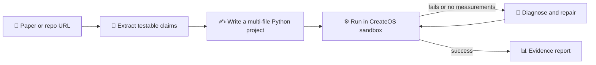
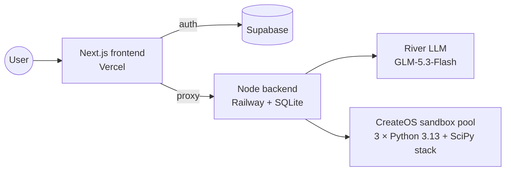

<div align="center">

# 🔬 Trace

**Paste a paper. Watch an agent test its claims.**

Trace reads an arXiv paper or GitHub repo, writes a focused experiment,
runs it in an isolated sandbox, and fixes its own code when it fails.

[](https://trace-two-livid.vercel.app)


</div>

---

## ✨ How it works



| | |
|---|---|
| 🎯 **Grounded claims** | Every claim quotes an exact excerpt from the source. |
| 🔁 **Self-repair** | Up to 3 attempts, each one learning from the last error. |
| 🔒 **Isolated runs** | Each attempt runs as a throwaway user with no network, plus memory, CPU, file and time limits. |
| 🚦 **Fair queue** | 3 shared sandboxes; users see their place in line. |
| 📥 **Exportable** | Download the protocol, code, output and limitations as a report. |

> [!NOTE]
> A successful run is **partial verification**, not proof a claim is true.

## 🏗️ Architecture



## 🧪 What it can test

| ✅ Good fit | ❌ Out of scope |
|---|---|
| CPU experiments up to 2 minutes per attempt | GPU training |
| Optimizer, init and normalization math | Large dataset downloads |
| Reduced toy versions of experiments | Full benchmark reproduction |
| arXiv HTML or text PDFs | Scanned PDFs |

**Try it with:** [Adam](https://arxiv.org/abs/1412.6980) · [Attention Is All You Need](https://arxiv.org/abs/1706.03762) · [Layer Norm](https://arxiv.org/abs/1607.06450)

## 🚀 Quick start

**You need:** Node 24, a [Supabase](https://supabase.com) project, a [River](https://river.ai) API key, and a CreateOS base sandbox with Python 3 with NumPy, SciPy, scikit-learn and pandas.

```bash
git clone https://github.com/birukabza/trace.git && cd trace
npm ci

# CreateOS credentials via Stripe Projects (writes .env)
stripe projects init
stripe projects add createos/project
stripe projects env --pull

cp .env.example .env.local   # fill in Supabase, River and sandbox ID
npm run dev                  # web on :3000, backend on :4000
```

<details>
<summary><b>🔑 Environment variables</b></summary>

| Variable | Where | What |
|---|---|---|
| `NEXT_PUBLIC_SUPABASE_URL` | both | Supabase project URL |
| `NEXT_PUBLIC_SUPABASE_PUBLISHABLE_KEY` | both | Supabase publishable key |
| `NEXT_PUBLIC_APP_URL` | frontend | Public frontend URL |
| `TRACE_BACKEND_URL` | frontend | Backend URL (server-only) |
| `RIVER_API_KEY` | backend | River API key |
| `CREATEOS_PROJECT_API_KEY` | backend | CreateOS key from Stripe Projects |
| `CREATEOS_SANDBOX_ID` | backend | Base sandbox to fork the pool from |
| `TRACE_SANDBOX_POOL_SIZE` | backend | Shared sandboxes, default `3` |
| `TRACE_DATA_DIR` | backend | SQLite location, `/data` in production |
| `FRONTEND_URL` | backend | Allowed frontend origin |

In Supabase, enable email/password auth and add `http://localhost:3000/auth/callback**` as a redirect URL.

> [!WARNING]
> The base sandbox is copied into every worker. Keep credentials and private files out of it.

</details>

<details>
<summary><b>☁️ Deploy</b></summary>

**Backend → Railway**
1. Deploy the repo with `Dockerfile.backend`.
2. Attach a volume at `/data`, keep 1 replica, health check `/healthz`.
3. Set the backend variables above, with `NODE_ENV=production`.

**Frontend → Vercel**
1. Import the repo as a Next.js project on Node 24.x.
2. Set the frontend variables, pointing `TRACE_BACKEND_URL` at Railway.
3. Add your Vercel domain to Supabase's Site URL and redirect URLs.

</details>

## 🛠️ Scripts

```bash
npm run dev         # frontend + backend with reload
npm test            # test suite
npm run typecheck   # TypeScript
npm run verify      # everything: types, tests, both builds
```

## 🤝 Contributing

Issues and pull requests are welcome.

1. Fork the repo and create a branch.
2. Make your change and run `npm run verify`.
3. Open a pull request describing what changed and why.

Good first areas: new source types, richer reports, and more numerical checks.

---

<div align="center">

Built for the CreateOS × Stripe hackathon · ⭐ Star the repo if it helped you

</div>
